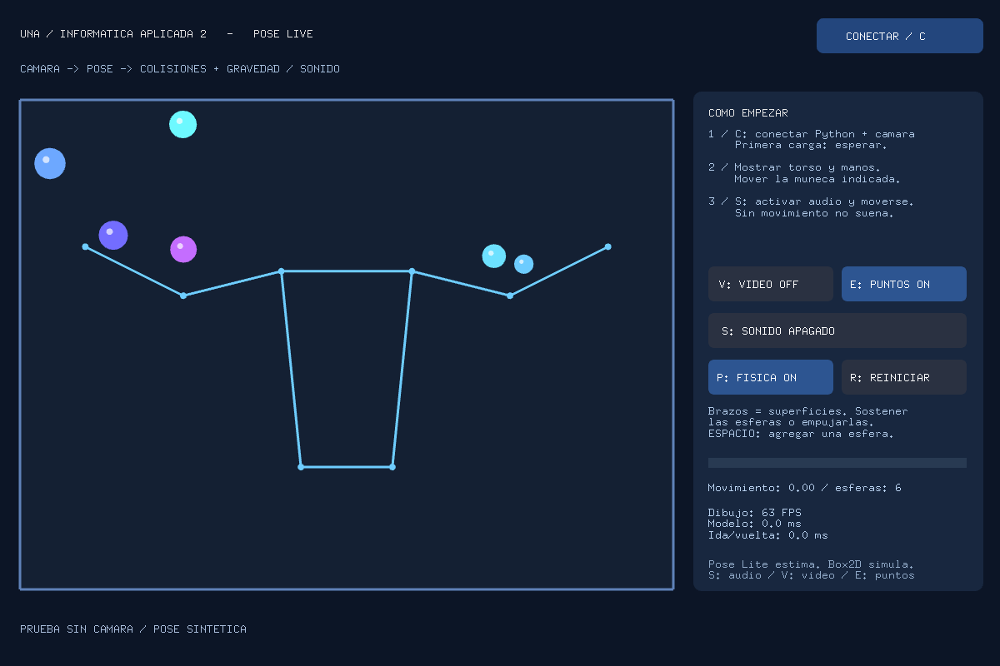
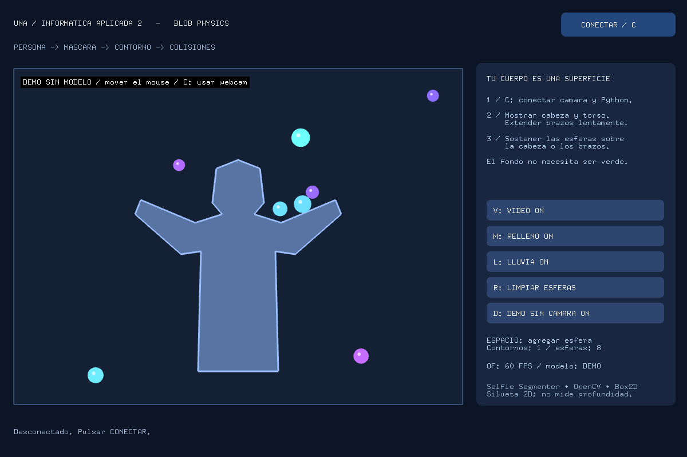
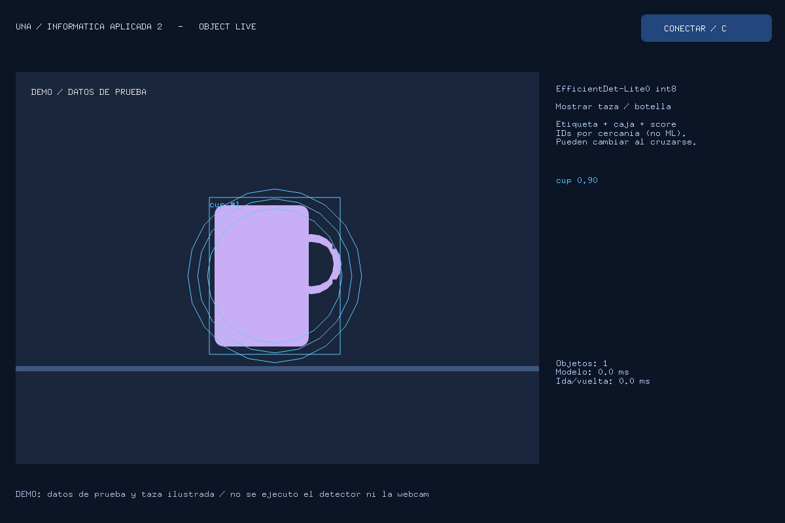
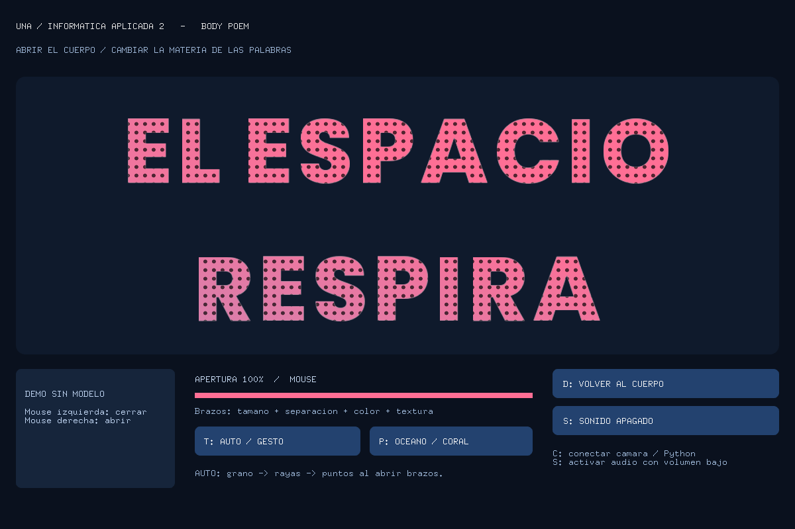
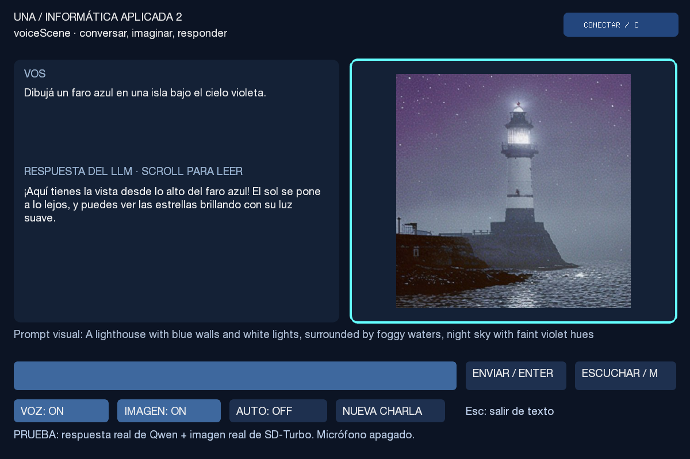
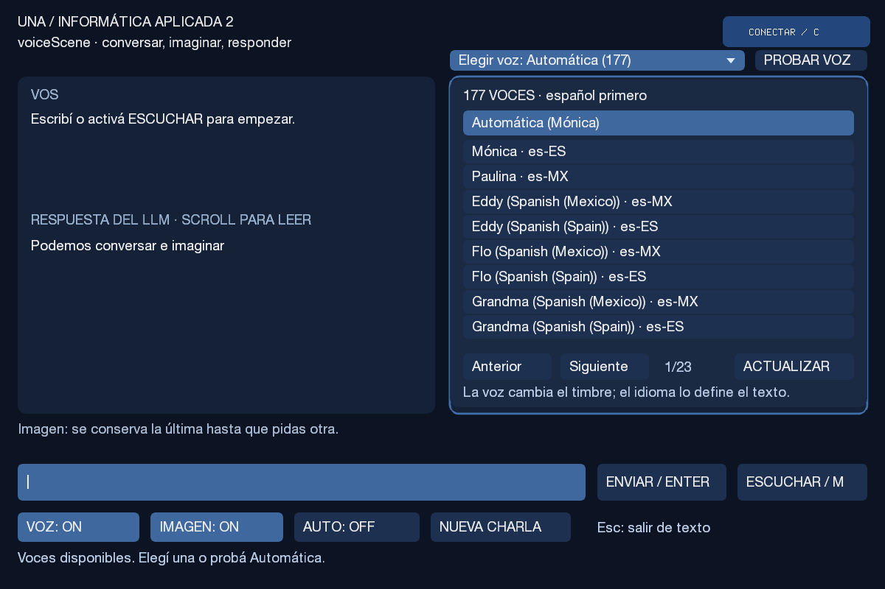
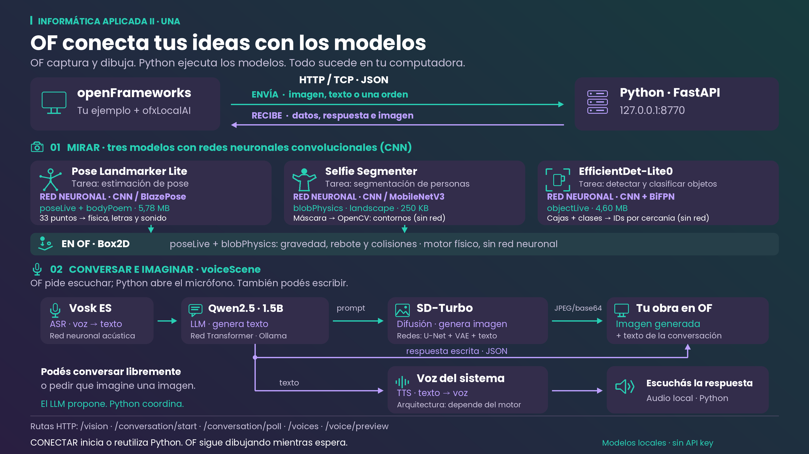

# Computer Vision · Interactive openFrameworks

Cinco ejemplos para construir instalaciones interactivas con **modelos locales**.
Usá el addon **ofxLocalAI** para enviar imágenes o pedidos desde openFrameworks y
transformar las respuestas en movimiento, física, tipografía, sonido o conversación.

**Empezá por los ejemplos de cámara:** usan modelos pequeños y CPU. La conversación
y la generación de imágenes se instalan como opciones adicionales. Sin Docker
ni API keys. La primera instalación requiere internet; la inferencia es local.

[Instalar](#instalación-paso-a-paso) · [Probar y modificar el código](docs/GUIA_CODIGO_OF.md) · [Resolver problemas](#si-algo-no-funciona)

## Qué podés construir

| Ejemplo | Entrada y modelo | Experiencia | Addons de OF |
| --- | --- | --- | --- |
| [poseLive](poseLive/README.md) | Webcam → Pose Landmarker Lite | Esqueleto, esferas que chocan con brazos/torso y tono según movimiento | ofxLocalAI + ofxBox2d |
| [blobPhysics](blobPhysics/README.md) | Webcam → Selfie Segmenter + OpenCV | Tu silueta sostiene y empuja objetos físicos | ofxLocalAI + ofxBox2d |
| [objectLive](objectLive/README.md) | Webcam → EfficientDet-Lite0 | Objetos con cajas, categorías e IDs; una taza activa anillos | ofxLocalAI |
| [bodyPoem](bodyPoem/README.md) | Webcam → Pose Landmarker Lite | Abrir los brazos transforma letras, colores, texturas y sonido | ofxLocalAI |
| [voiceScene](voiceScene/README.md) | Texto/micrófono → Qwen + Vosk + TTS; SD-Turbo opcional | Conversación con contexto, respuesta hablada e imagen generada | ofxLocalAI |

### Pose y silueta con física

| poseLive | blobPhysics |
| --- | --- |
|  |  |
| Captura de prueba con puntos sintéticos; muestra la interacción física. | Modo D: figura de demostración controlada con mouse, sin modelo. |

### Detección y tipografía interactiva

| objectLive | bodyPoem |
| --- | --- |
|  |  |
| Captura con datos de prueba y una taza ilustrada; no es una inferencia real. | Modo D: la apertura se controla con mouse, sin cámara. |

### Conversación e imágenes



Captura de una prueba con **respuesta real de Qwen e imagen real de SD-Turbo**,
sin micrófono. Corresponde a una versión anterior del selector de voces; la
versión actual también permite elegir y probar el timbre:

<details>
<summary>Ver el selector de voces</summary>



</details>

<!-- VIDEO_DEMO: agregar aquí el enlace al video cuando esté disponible. -->

## Instalación paso a paso

### 1. Descargar y guardar este repositorio

Descargá **Code → Download ZIP** en GitHub y extraelo, o cloná el repositorio con
Git:

```sh
git clone https://github.com/noequalindi/computer-vision-interactive-openFrameworks.git
cd computer-vision-interactive-openFrameworks
```

Conservá la carpeta completa en una ubicación definitiva. No ejecutes los
scripts dentro del ZIP ni copies `.venv` desde otra computadora.

Abrí una terminal en esa carpeta: tenés que ver `setup_local.py`, `realtime/`,
`ofxLocalAI/` y los cinco ejemplos. El entorno Python permanece acá, separado del
SDK de openFrameworks.

### 2. Preparar Python y descargar modelos

Elegí **una columna** según lo que quieras probar:

| Sistema / terminal | Cámara, pose, objetos, silueta y tipografía | Agregar conversación y voz | Agregar también imágenes generadas |
| --- | --- | --- | --- |
| macOS | `bash install_env_mac.command` | `bash install_env_mac.command --voice` | `bash install_env_mac.command --voice --images` |
| Linux | `bash install_env_linux.sh` | `bash install_env_linux.sh --voice` | `bash install_env_linux.sh --voice --images` |
| Windows · PowerShell | `.\install_env_windows.cmd` | `.\install_env_windows.cmd -Voice` | `.\install_env_windows.cmd -Voice -Images` |
| Windows · CMD | `install_env_windows.cmd` | `install_env_windows.cmd -Voice` | `install_env_windows.cmd -Voice -Images` |

No necesitás activar un entorno antes: el script obtiene **uv y Python 3.11**,
crea `.venv`, instala las dependencias y descarga los tres modelos de cámara en
`models/`. Al terminar escribe `bin/data/local-service.json` en los ejemplos con
la ruta de tu instalación.

Con `--voice` instala/reutiliza **Ollama**, descarga Qwen y prepara Vosk. En Windows
puede abrirse el instalador de Ollama: completá ese asistente. Con `--images` agrega
PyTorch, Diffusers y SD-Turbo. Podés volver a ejecutar el instalador para sumar una
opción; conserva los modelos ya descargados.

Los scripts **no instalan openFrameworks, su compilador ni los addons de C++**.
El servicio Python no tiene que quedar abierto al instalar: después se inicia al
pulsar CONECTAR desde OF. Ollama se inicia/reutiliza cuando empieza un turno de voz.

En Linux, los ejemplos pueden requerir bibliotecas del sistema. Para Debian/Ubuntu:

```sh
sudo apt install libgl1 libglib2.0-0
# Para voiceScene con micrófono y voz:
sudo apt install libportaudio2 espeak-ng
```

En macOS/Linux usamos `bash archivo` para que el arranque no dependa del permiso
ejecutable del archivo descargado. En Windows usá el lanzador `.cmd` indicado.

### 3. Preparar openFrameworks y los addons

Instalá **openFrameworks 0.12.1**, su herramienta de compilación y Project Generator
según tu sistema: [descarga e instrucciones oficiales](https://openframeworks.cc/download/).

1. Copiá **toda** la carpeta `ofxLocalAI` de este repositorio a `OF/addons/ofxLocalAI`.
2. Para **poseLive y blobPhysics**, instalá también
   [ofxBox2d](https://github.com/vanderlin/ofxBox2d) en `OF/addons/ofxBox2d`.
   Si lo descargás como ZIP, renombrá `ofxBox2d-master` a `ofxBox2d`.
3. Copiá los ejemplos que quieras a `OF/apps/myApps/`, con sus carpetas completas:
   `src/`, `bin/data/` y `addons.make`. En bodyPoem son necesarias las fuentes y los shaders.

La estructura debe quedar así (OF representa la carpeta del SDK):

```text
computer-vision-interactive-openFrameworks/    ← este repo: Python y modelos
├── .venv/                                   ← creado por el instalador
├── models/                                  ← descargados por el instalador
└── realtime/

OF/
├── addons/
│   ├── ofxLocalAI/
│   └── ofxBox2d/                            ← sólo poseLive/blobPhysics
└── apps/myApps/
    ├── poseLive/src/ofApp.cpp
    ├── blobPhysics/src/ofApp.cpp
    ├── objectLive/src/ofApp.cpp
    ├── bodyPoem/src/ofApp.cpp
    └── voiceScene/src/ofApp.cpp
```

No hacen falta OSC, TUIO ni ofxOpenCv para estos ejemplos. OpenCV se ejecuta en Python.

### 4. Generar el proyecto correcto

En **Project Generator**, importar/actualizar el proyecto existente. Por ejemplo:

| Campo | Para blobPhysics |
| --- | --- |
| Project path | `OF/apps/myApps` |
| Project name | `blobPhysics` |
| Addons | `ofxLocalAI` y `ofxBox2d` |
| Additional source paths | Vacío |

Pulsá **Update**. El proyecto resultante debe estar junto a `src`, dentro de
`OF/apps/myApps/blobPhysics`. Para otro ejemplo cambiá el nombre y los addons
según la tabla inicial.

**Comprobación importante:** abrí el `src/ofApp.cpp` que vas a compilar. Debe tener
el código del ejemplo. Si se generó otro `mySketch` o una carpeta anidada con un
`ofApp.cpp` vacío, se está compilando el esqueleto equivocado: corregí Project path
antes de continuar.

### 5. Compilar y ejecutar

En macOS/Linux, abrí una terminal en el ejemplo generado, por ejemplo
`OF/apps/myApps/blobPhysics`, y ejecutá:

```sh
make Release -j4
make RunRelease
```

En Windows, abrí el proyecto generado en Visual Studio, elegí **Release** y la
plataforma correspondiente a tu SDK de OF, compilá y ejecutá. Usá el compilador
indicado por las instrucciones de tu distribución de openFrameworks.

### 6. Conectar desde OF

1. Abrí **un ejemplo a la vez** y pulsá **CONECTAR** (C en los ejemplos de cámara).
2. Si pide una carpeta, elegí **el repositorio donde instalaste Python**, no el
   sketch copiado en OF. El addon busca/reutiliza el servicio en `127.0.0.1:8770`
   o inicia el Python local de ese repositorio.
3. Autorizá la cámara. En macOS revisá Privacidad y seguridad → Cámara y permití
   el acceso a la app/terminal desde la que estás ejecutando.
4. Esperá el primer resultado: cargar un modelo demora más que procesar los siguientes cuadros.
5. Probá los controles de la [guía de ejercicios](docs/GUIA_CODIGO_OF.md).

bodyPoem y blobPhysics también tienen **D: demo con mouse**, sin cámara ni ML.
Para volver a entrada real, pulsá C. Los sonidos corporales comienzan apagados:
**S** los activa. El micrófono de voiceScene se abre con ESCUCHAR/AUTO, no al iniciar la app.

Si instalaste voiceScene **sin `--images`**, apagá IMAGEN antes de enviar un turno.
Para escribir y conversar no hace falta activar el micrófono. La primera respuesta
puede demorar mientras se carga Qwen. [Controles, voces y hardware de voiceScene](voiceScene/README.md).

Al cerrar OF se detiene el servidor que inició esa aplicación. Un servidor abierto
previamente por terminal se conserva. Para iniciarlo manualmente y ver sus mensajes:

| Sistema | Comando desde la raíz del repo |
| --- | --- |
| macOS | `bash start_local_mac.command` |
| Linux | `bash start_local_linux.sh` |
| Windows | `start_local_windows.cmd` (PowerShell: `.\start_local_windows.cmd`) |

## Modelos, hardware y espacio

| Componente | Tipo / tarea | Pesos o descarga aproximada |
| --- | --- | --- |
| Pose Landmarker Lite | Red CNN: estimación de 33 puntos corporales | 5,78 MB |
| Selfie Segmenter landscape | Red CNN/MobileNetV3: máscara de persona | 250 KB |
| EfficientDet-Lite0 int8 | Red CNN + BiFPN: cajas, clases y scores | 4,60 MB |
| Vosk español pequeño, opcional | Modelo acústico neuronal: transcripción | 39 MB de ZIP |
| Qwen2.5 1.5B Instruct, opcional | LLM Transformer: conversación | ~1 GB |
| SD-Turbo, opcional | Redes de difusión destiladas: texto → imagen | ~2,6 GB |
| TTS del sistema | Pronuncia texto; arquitectura según motor/voz | Depende de voces instaladas |

La geometría de contornos de OpenCV, los IDs por cercanía y la física de Box2D
son algoritmos programados: no ejecutan otra red neuronal en este kit.

- **Cámara:** CPU de 64 bits; GPU no requerida. 8 GB de RAM recomendados con IDE
  y navegador; 4 GB es sólo una orientación, no un mínimo validado. Prever 4 GB de
  disco para entorno y cachés, además del SDK de OF.
- **Conversación:** 8 GB de RAM orientativos y 8 GB de disco disponibles para entorno/modelos.
- **Imágenes generadas:** 16 GB de RAM orientativos y 12 GB de disco disponibles.
  En CPU puede tardar minutos. Ollama selecciona aceleración según el equipo;
  Diffusers usa CUDA, MPS o CPU según PyTorch y el hardware disponibles.
- Destinos: macOS Intel/Apple Silicon, Windows x64 y Linux x86_64 con Python 3.11.
  Se probó en macOS Apple Silicon y OF 0.12.1; Windows/Linux necesitan prueba nativa.

La interfaz intenta dibujar a 60 FPS, con pedidos de cámara limitados a 15 por
segundo para pose/silueta y 10 para objetos. Son límites, no garantías. Una imagen
generativa no tiene la misma latencia que pose o detección.

## Cómo se conectan



OF captura/envía, Python procesa y responde, y OF transforma los datos en una obra.
HTTP transporta pedidos/respuestas; JSON organiza los datos; JPEG/base64 permite
incluir imágenes en ellos. Los modelos de cámara analizan imágenes; SD-Turbo genera
imágenes. La interfaz conversacional coordina varios modelos, no un único modelo multimodal.

[Comparación ilustrada de pose, segmentación y detección](redes_vision_como_funcionan.png).

## Probar y crear tu propia interacción

Seguí [GUIA_CODIGO_OF.md](docs/GUIA_CODIGO_OF.md). Incluye para cada ejemplo:

- Cómo activarlo y qué resultado esperar.
- Dónde enviar un pedido y recibir su respuesta.
- Qué función transforma esa respuesta en dibujo, física o sonido.
- Cambios concretos para comentar/descomentar y una consigna propia.

## Si algo no funciona

| Síntoma | Qué revisar |
| --- | --- |
| Ventana gris o ejemplo vacío | El `src` que compilaste y el Project path. No debería existir otro esqueleto anidado. |
| No encuentra `ofxLocalAI` / `ofxBox2d` | Carpetas dentro de `OF/addons`, nombres exactos, addons.make y Update en Project Generator. |
| No encuentra Python o pide carpeta | Terminar el instalador en este repositorio y seleccionarlo desde OF. No elegir `OF/apps/myApps`. |
| Faltan pesos | Repetir install_env con las opciones elegidas. Sólo cámara: `.venv/bin/python -m realtime.download`; Windows: `.venv\Scripts\python.exe -m realtime.download`. |
| No abre cámara | Permisos del SO y `bin/data/camera.json` del sketch: `device` selecciona el índice. Cerrar otra app que la esté usando. |
| HTTP 422 / servidor anterior | Cerrar el servidor antiguo y reconectar con las copias actualizadas de Python y ofxLocalAI; revisar el mensaje de error en consola. |
| Imagen de cámara con retardo | Es la imagen que produjo el resultado. Reducir `targetFps` limita carga; no aumenta la velocidad del modelo. Usar buena luz y movimientos lentos. |
| S está activo pero no suena | En poseLive/bodyPoem el volumen depende del gesto. Revisar movimiento, puntos visibles y salida de audio. |
| Falta Ollama / no conversa | Repetir instalación con `--voice` / `-Voice`. Revisar los mensajes del servicio. |
| No genera imagen o falta memoria | Apagar IMAGEN para conversar; instalar con `--images` / `-Images` para habilitar SD-Turbo. |
| Siempre se oye la misma voz | Elegir un timbre en el desplegable y luego PROBAR VOZ. El botón de prueba no cambia de voz. |

Para actualizar: cerrar el ejemplo/servicio, actualizar el repositorio, repetir
el instalador si cambiaron dependencias o modelos, actualizar las copias del addon
**y del ejemplo completo** en OF y recompilar. Si moviste el repositorio después
de instalar, regenerá el entorno con el instalador: los entornos contienen rutas absolutas.

## Fuentes y licencias

Los pesos se descargan de sus distribuidores y conservan sus propias condiciones:
[Pose Landmarker](https://developers.google.com/edge/mediapipe/solutions/vision/pose_landmarker),
[Selfie Segmenter](https://developers.google.com/edge/mediapipe/solutions/vision/image_segmenter),
[EfficientDet](https://developers.google.com/edge/mediapipe/solutions/vision/object_detector),
[Vosk](https://alphacephei.com/vosk/models),
[Qwen2.5](https://huggingface.co/Qwen/Qwen2.5-1.5B-Instruct) y
[SD-Turbo](https://huggingface.co/stabilityai/sd-turbo).
Dependencias: [MediaPipe](https://github.com/google-ai-edge/mediapipe),
[openFrameworks](https://openframeworks.cc/) y [ofxBox2d](https://github.com/vanderlin/ofxBox2d).
La fuente de bodyPoem incluye su licencia en `bin/data/fonts/`.

No se versionan pesos, entornos, binarios, rutas de instalación ni material docente privado.

## Desarrollo

```sh
.venv/bin/python -m pip install -r requirements-dev.txt
.venv/bin/python -m pytest -q
# Comprobación de sintaxis contra un SDK macOS existente:
.venv/bin/python tools/check_of_headers.py /ruta/a/of_v0.12.1_osx_release
```

En Windows sustituir `.venv/bin/python` por `.venv\Scripts\python.exe`.
