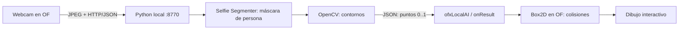

# blobPhysics — tu figura juega con objetos

La webcam ve a una persona. **Selfie Segmenter landscape** estima su máscara;
**OpenCV** obtiene los contornos; **Box2D** hace caer esferas y resuelve sus choques.
El cuerpo se vuelve una superficie donde sostener o empujar elementos.

[Instalación general](../README.md) · [Guía del código](../docs/GUIA_CODIGO_OF.md#blobphysics)

## Preparar y ejecutar

1. Ejecutar `install_env` de tu sistema. Si ya preparaste el entorno, alcanza con
   `.venv/bin/python -m realtime.download` desde el repositorio (Windows:
   `.venv\Scripts\python.exe -m realtime.download`). Descarga el nuevo modelo de
   **250.177 bytes (~250 KB)** y conserva los que ya tenés.
2. Copiar la versión actual de `ofxLocalAI/` a `OF/addons/ofxLocalAI/`.
   Instalar también [ofxBox2d](https://github.com/vanderlin/ofxBox2d) en
   `OF/addons/ofxBox2d/`; no copiarlo dentro del proyecto.
3. Copiar `blobPhysics/` a `OF/apps/myApps/blobPhysics/`.
4. Project Generator: **Project path = `OF/apps/myApps`**, **Project name =
   `blobPhysics`**, addons **ofxLocalAI + ofxBox2d**, Additional source paths vacío.
   **Update**, compilar y ejecutar. No crear otro esqueleto dentro de `blobPhysics`.
5. Cerrar cualquier servidor anterior y otros ejemplos. Pulsar **C / CONECTAR**;
   el addon inicia el Python local y la webcam. Si pide una carpeta, elegir este
   repositorio (donde está `.venv`), no la copia del sketch en OF.

En macOS/Linux, desde el proyecto generado: `make Release -j4` y `make RunRelease`.
En Windows usar el proyecto generado para Visual Studio. CPU suficiente; no requiere
Ollama, GPU, API key ni pantalla verde. El primer cuadro carga el modelo.

## Recorrido de la información

## Qué mostrar

- Dejar cabeza, torso y brazos dentro del cuadro, con buena iluminación.
- Extender los brazos: las esferas pueden caer sobre la silueta.
- Moverse lentamente para empujarlas. Ocultar el video con **V** para ver sólo la figura.
- Salir de cuadro: desaparece el contorno y los objetos caen hasta el suelo.
- Para explicar la física sin webcam: **D**, mover el mouse. Aparece **DEMO SIN MODELO**.
  Esa figura está dibujada a mano; **C** vuelve a la entrada real.

| Control | Acción |
| --- | --- |
| C | Conectar webcam y servicio Python |
| V | Mostrar/ocultar video; la captura sigue activa |
| M | Mostrar/ocultar relleno; conserva borde y colisiones |
| L | Activar/desactivar lluvia automática de esferas |
| Espacio | Agregar una esfera |
| R | Quitar esferas; si L está activado seguirán apareciendo |
| D | Alternar demostración con mouse, sin inferencia |

## Dónde cambiar la obra

En `src/ofApp.cpp` están marcados los pasos **[1] a [5]**:

- `sendFrame("silhouette")`: pedir segmentación de persona.
- `onResult()`: recorrer `result["blobs"]`; cada blob incluye `id`, `area`, centro,
  caja y `contour`, en coordenadas normalizadas. La app usa el contorno.
- `physics.setContours(contours)`: darle superficies al mundo físico.
- `physics.update(...)`: avanzar gravedad y colisiones.
- `draw()`: cambiar cómo se ve la silueta o reemplazar su relleno por una textura.

En `ofxLocalAI/src/ofxBodyPhysics.h`, `spawn()` define radio, material y color de
los objetos. `setup()` define gravedad; `setContours()` crea aristas cerradas.
No hace falta cambiar el servidor para inventar otra interacción.

**Consigna:** «Sostener lo que cae». Transformar las esferas en palabras o signos
mediante el dibujo y discutir qué representa sostenerlos con el cuerpo. Empezar
cambiando color/rebote y comparar la experiencia con/sin superficie corporal.

## Límites que conviene explicar

El modelo segmenta **personas**, no cualquier objeto. «Blob» es aquí una región
conectada de esa máscara: no implica reconocer identidad. OpenCV filtra regiones
pequeñas y simplifica cada contorno a un máximo de 96 puntos, hasta 4 regiones.
Dos personas que se tocan pueden formar un solo blob; no es segmentación por instancia.
Los huecos interiores se rellenan a efectos físicos: usamos contornos externos.

Los colliders se reconstruyen al recibir cada respuesta; los objetos que quedaron
atrapados por el cambio se desplazan fuera del contorno con un empuje limitado.
Es una aproximación para interacción 2D, no un cuerpo articulado ni una medición de
fuerza o profundidad. Puede vibrar en bordes inestables, movimientos rápidos u
oclusiones. Para cuerpo entero probar encuadre e iluminación: Selfie Segmenter se
orienta a personas en escenas tipo videollamada. Como máximo hay 60 esferas.

[Modelo oficial](https://ai.google.dev/edge/mediapipe/solutions/vision/image_segmenter)
· [ofxBox2d](https://github.com/vanderlin/ofxBox2d).
